# okc visuals (judge H200 traces; regenerate: `tools/visuals.py`)

## Board

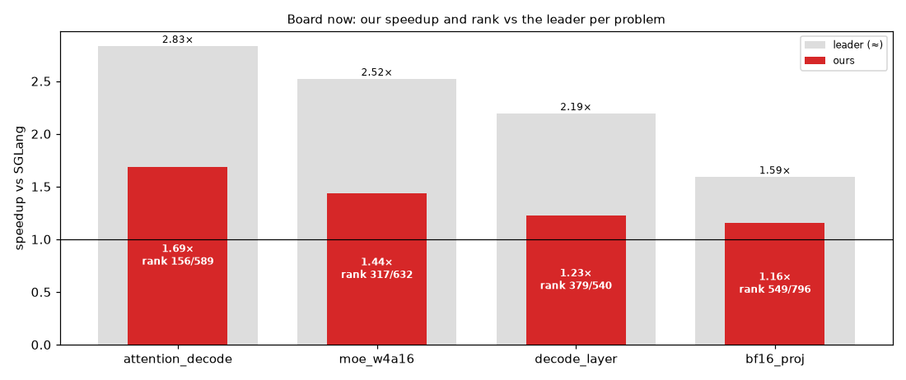

## muse_moe_w4a16 (trace job be92d308ebb84691)

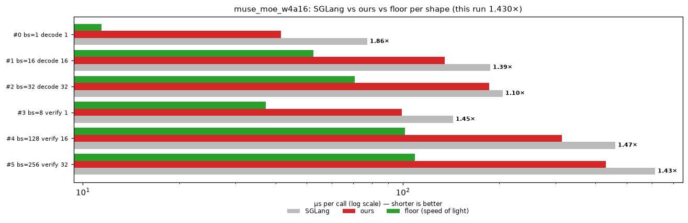

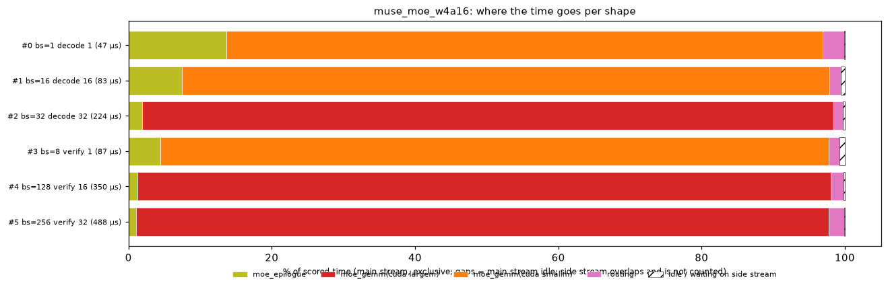

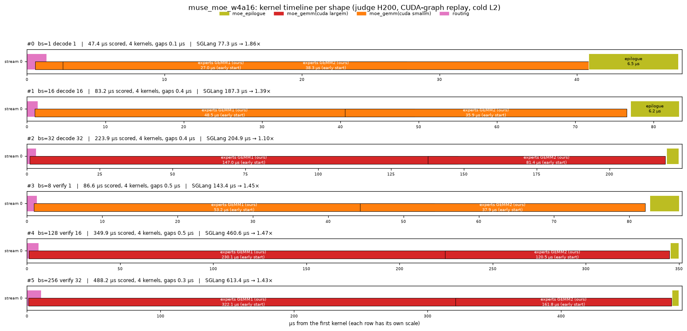

## muse_decode_layer (trace job dc147ca3cf424749)

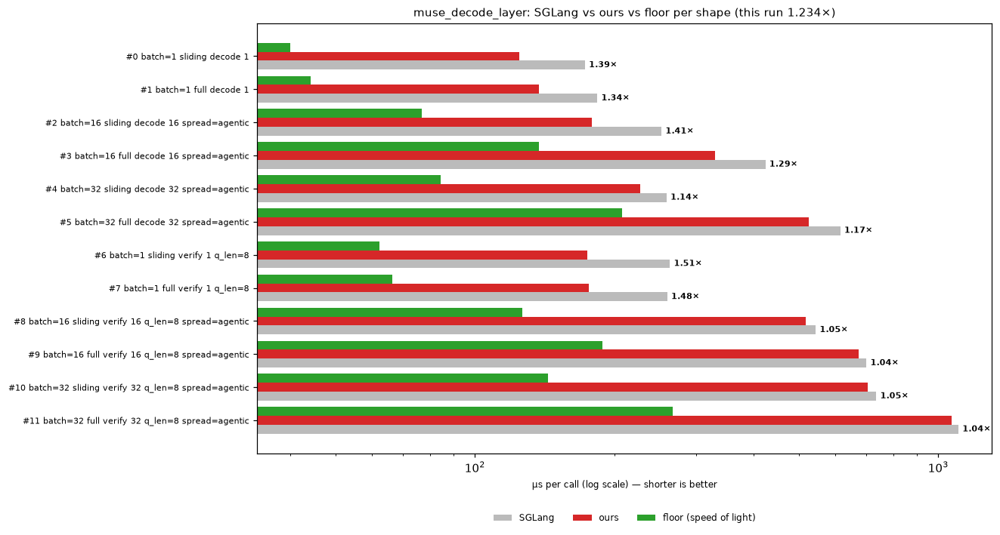

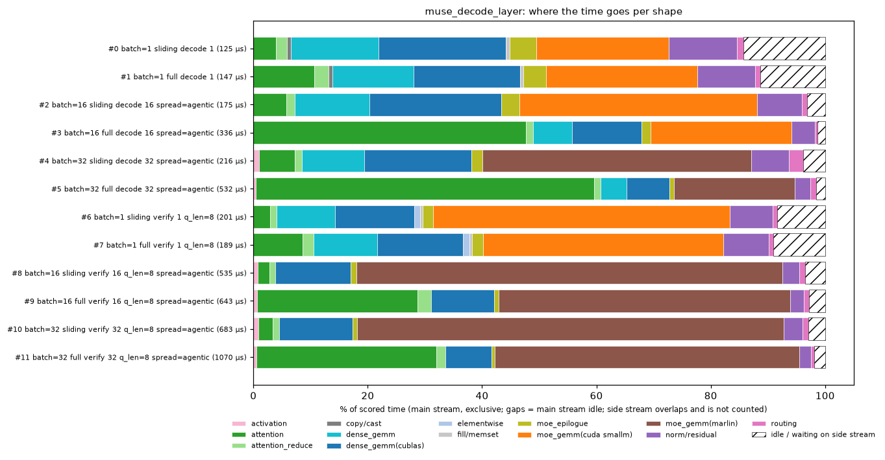

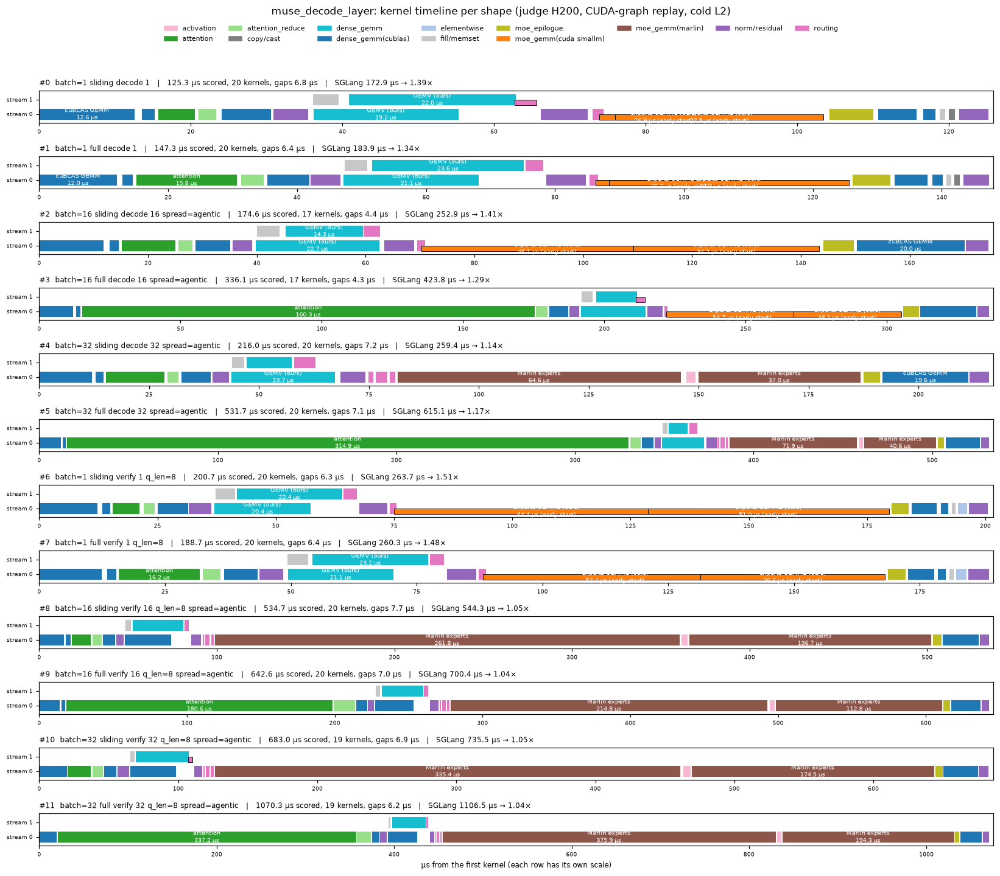

## muse_attention_decode (trace job 9b13f66ac5494fb3)

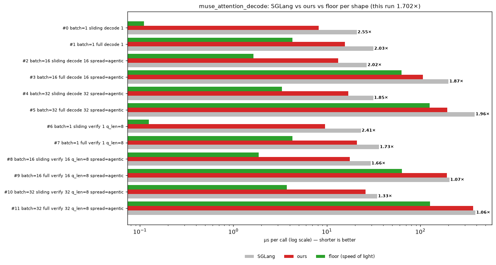

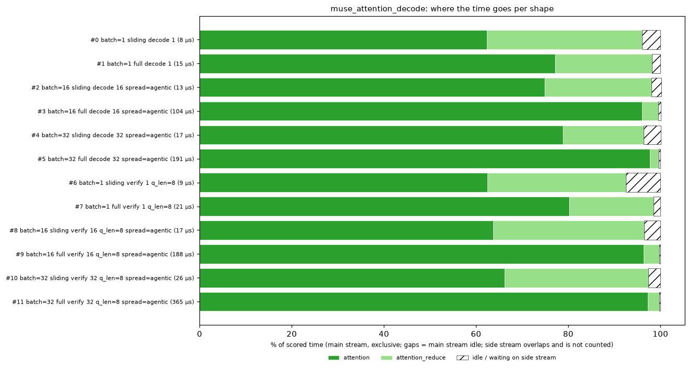

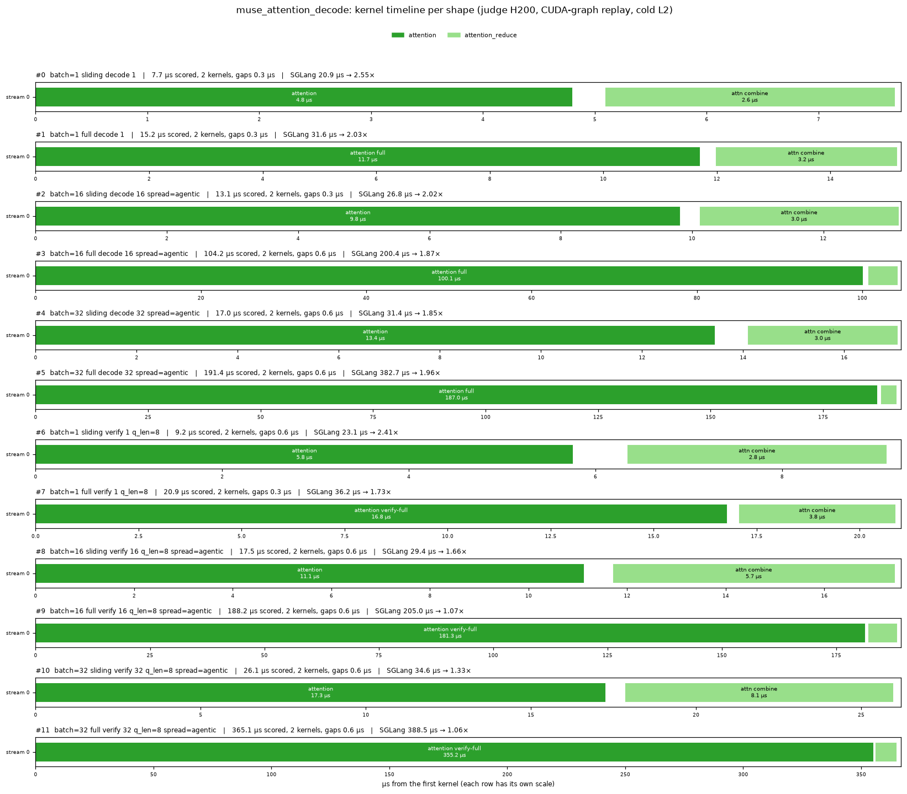

## muse_bf16_proj (trace job c2820491c4e14c75)

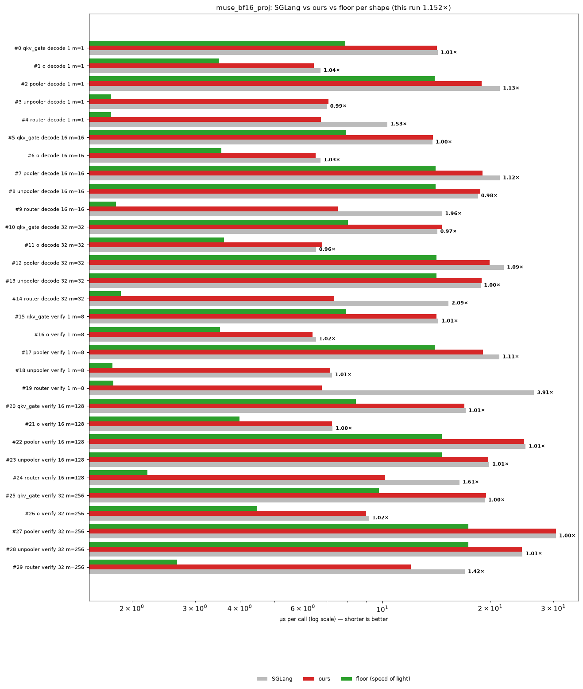

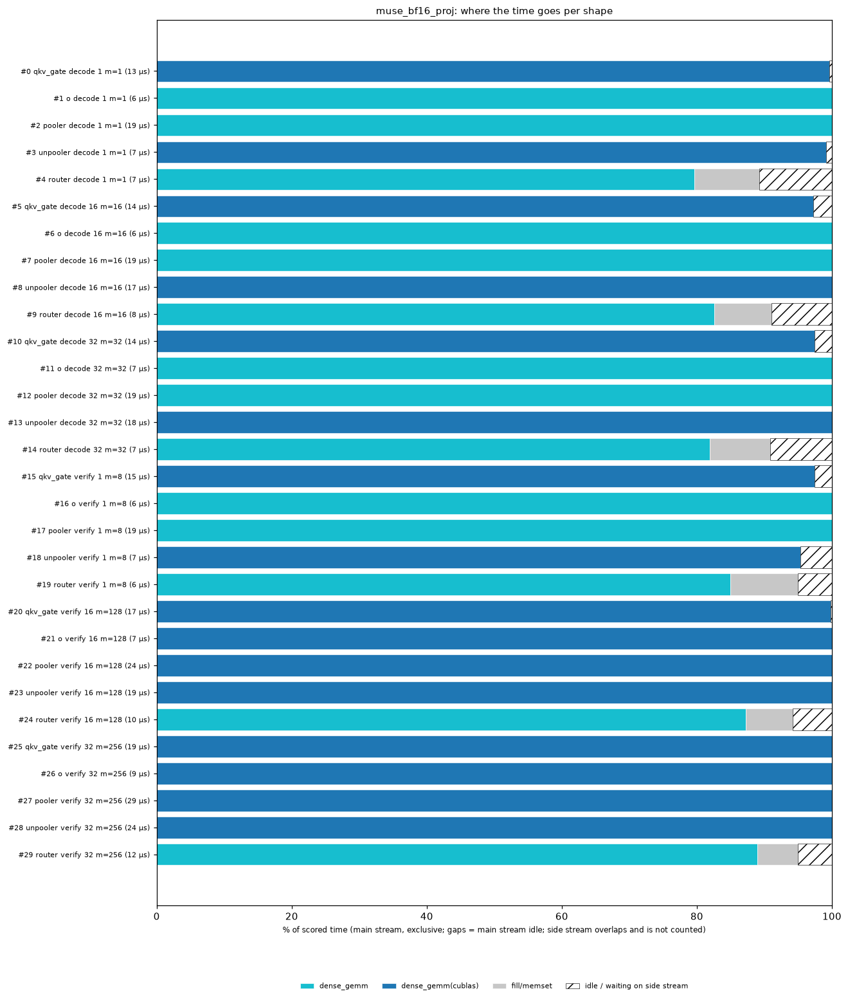

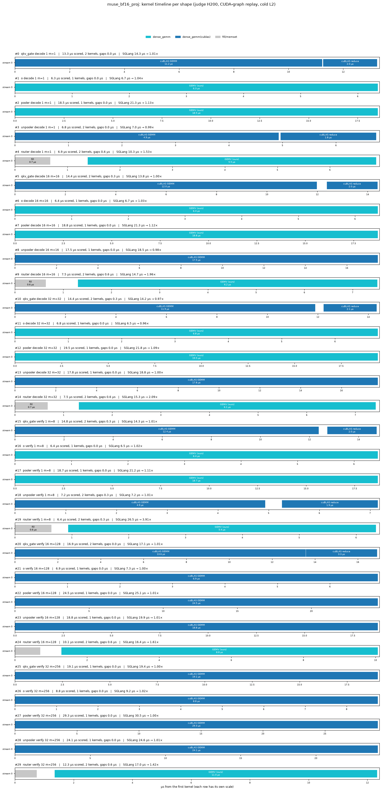

